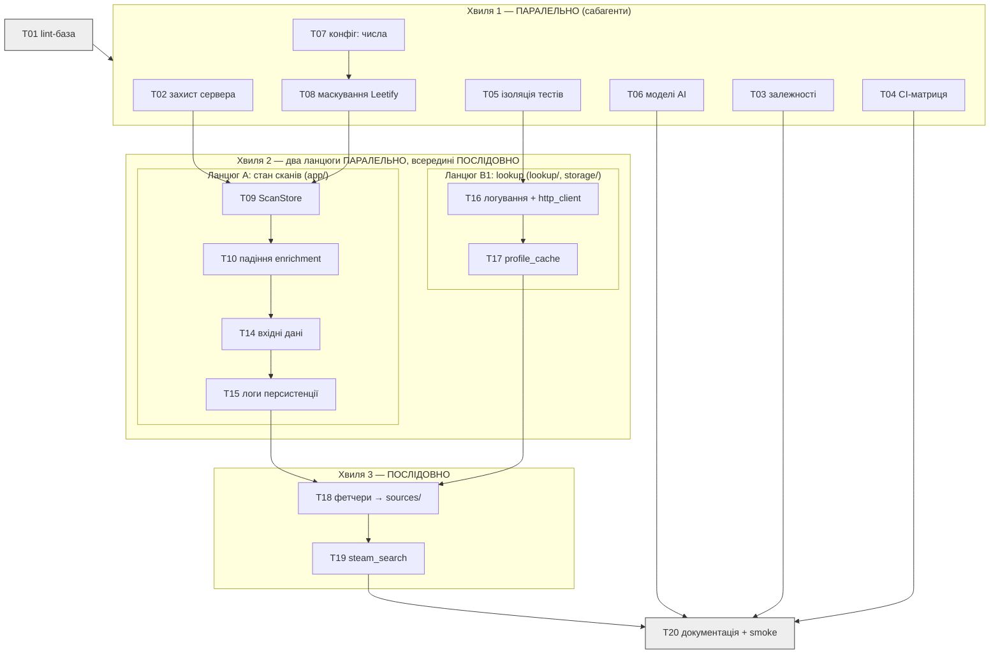

# План покращень cs2-scoreboard-watch

Статус: **виконано** (2026-11-14), крім відкладених T11–T13 (`docs/improvements/deferred/`) і незавершеного smoke T20:
`GET /api/latest` повертає 500 у worktree через запис тестом `failscan01` у `data/scans_history.json` (див.
«Known limitations» в `docs/ARCHITECTURE.md`).

Змерджені PR: T01 #25, T02 #28, T03 #27, T04 #26, T05 #29, T06 #31, T07 #32, T08 #34, T09 #37, T10 #38, T14 #39,
T15 #40, T16 #33, T17 #35, T18 #41, T19 #42; хотфікси: #30 (CI 3.13 non-blocking), #36 (taskctl non-blocking).

Зміст:

1. [Аналіз поточного стану](#1-аналіз-поточного-стану)
2. [Список покращень](#2-список-покращень)
3. [Схема впровадження](#3-схема-впровадження)
4. [Модель виконання: агенти, борда, гейти](#4-модель-виконання-агенти-борда-гейти)
5. [Ризики і відкриті питання](#5-ризики-і-відкриті-питання)

Задачі: [`tasks/`](tasks/) (по одному файлу на задачу, з машиночитним заголовком).
Відкладені задачі про гонки (T11–T13): [`deferred/`](deferred/) — окремий етап після цього плану.
Агенти: [`.claude/agents/orchestrator.md`](../../.claude/agents/orchestrator.md),
[`.claude/agents/middle-dev.md`](../../.claude/agents/middle-dev.md).
Інструмент гейтів і борди: [`scripts/agents/taskctl.py`](../../scripts/agents/taskctl.py).

---

## 1. Аналіз поточного стану

Перевірено на `main` @ `6db23e9` (після PR #6). Тести: `Ran 398 tests … OK (expected failures=3)`.

### Що вже добре

- **Чіткі межі пакетів** (`app/ storage/ vision/ lookup/ sources/ scoring/ cs2platform/ web/`), runtime-стан
  ізольований у `data/` (gitignored), шляхи визначені в одному місці (`storage/paths.py`).
- **Плагінна модель джерел**: `sources/base.py` (`DataSource`, `SourceRegistry`), додати джерело = файл + рядок у
  `sources/registry.py`. Налаштування джерел декларативні (`storage/config_fields.py`).
- **Скоринг як дані + правила**: `scoring/thresholds.py` + `@rule` у `scoring/rules.py`, golden-тест на 27 гравців.
- **Pipeline з інʼєкцією залежностей**: `app/pipeline.py` не має глобального стану, тести підставляють фейки.
- **Golden/parity-тести** для скорингу, AI-payload, feedback, конфігу і рендеру фронтенду; заморожена таблиця
  маршрутів (`tests/test_router.py`); атомарні записи (`storage/atomic_io.py`).
- **CI** з unittest + Node-тестами фронтенду і авто-мерджем за фразою в коміті.

### Проблеми (з доказами)

| # | Проблема | Де | Наслідок |
|---|---|---|---|
| P1 | **Немає захисту локального сервера від CSRF / DNS-rebinding.** Не перевіряються `Host`, `Origin`, `Content-Type`. | `app/server.py` `CsWatchHandler.do_GET/do_POST`, `app/web_router.read_json_body` | Будь-який сайт, відкритий у браузері, може `fetch("http://127.0.0.1:8765/api/config", {method:"POST", mode:"no-cors", body: "..."})` і змінити налаштування / ключі, запустити `/api/scan` з довільним `image_path`, переписати `autoexec.cfg` через `/api/setup-cs2`. Через DNS-rebinding можна ще й читати `GET /api/config` (Leetify-ключ віддається відкритим). |
| P2 | **`lookup/steam_lookup.py` — god-module (1557 рядків)**: HTTP-клієнт, rate-limit Steam, пошук і матчинг профілів, кеш профілів, фетчери Leetify/FACEIT/CSTracker/Steam stats, побудова `PlayerReport`, оркестрація enrichment, логування. | `lookup/steam_lookup.py` | `sources/*.py` роблять late-import назад у `steam_lookup` (`steam_lookup._fetch_leetify`) — залежність інвертована; файл важко змінювати і тестувати частинами. |
| P3 | **Сайд-ефект при імпорті**: `_setup_pton_log()` викликається на рівні модуля і створює `data/logs/pton.logs`. | `lookup/steam_lookup.py:34-49` | `--help`, тести і будь-який імпорт пишуть у `data/`. |
| P4 | **Стан сканів — модульні глобали + мутації розкидані по маршрутах.** `_SCANS`, `_STATE_LOCK`, `_save_history_locked` у `app/server.py`; записи робить не тільки pipeline, а й `_post_recheck`, `_post_ai_analyze`, `recheck_source_for_player`. Документ стверджує «pipeline — єдиний код, що пише scan records», це вже неправда. | `app/server.py` | Гонки нижче; неможливо тестувати сховище окремо. |
| P5 | **Гонки та втрачені оновлення** (частина вже задокументована як Known limitations): rescan + стара enrichment; фінальний запис enrichment перетирає паралельні recheck/AI; `/api/recheck` пише за індексом; `/api/ai-analyze` з дублями ніків; падіння enrichment лишає скан у `loading_*` назавжди. | `app/pipeline.py`, `app/server.py`; 3 `expectedFailure` у `tests/test_player_uid.py` | Невірні дані в UI та історії. |
| P6 | **Тихе ковтання помилок персистенції**: `_save_history_locked` і `_load_history` роблять `except Exception: pass`. | `app/server.py` | Втрата історії без жодного сліду в логах. |
| P7 | **Конфіг**: `inf`/`nan` у `data/config.json` скидає *всі* налаштування; збереження `inf` дає 500. Leetify-ключ не маскується. | `storage/config_schema.py:92-122`, `sources/leetify.py` (`masked=False`) | Втрата налаштувань, витік ключа через API. |
| P8 | **Вхідні дані без обмежень**: `POST /api/scan` приймає довільний `image_path` з диска; `POST /api/upload` пише будь-які байти як `.png`. | `app/server.py` `_post_scan`, `_post_upload` | Читання/OCR довільних файлів; сміття в `screenshots/`. |
| P9 | **Застарілі ідентифікатори моделей AI**: `claude-sonnet-4-20250514`, `claude-3-5-haiku-latest`, `claude-opus-4-20250514`. | `lookup/ai_analyzer.py:207-211` | API-провайдер AI ламається, коли моделі знімаються з підтримки. |
| P10 | **Немає лінтера / статичних перевірок у CI**, тестується лише Python 3.11, хоча `requires-python = ">=3.11"`. | `.github/workflows/tests.yml`, `pyproject.toml` | Мертвий код і помилки імпорту ловляться пізно. |
| P11 | **Невикористана залежність** `playwright` (важка, тягне браузери) у `requirements.txt` і `pyproject.toml`. | | Повільна установка, зайва поверхня атаки. |
| P12 | **Старі тести не ізольовані від `data/`** (`test_scoring_f4`, `test_nick_match`, `test_steam_queue`, `test_stale_cache_fallback` — «not audited» за `ARCHITECTURE.md`). | `tests/` | Тести можуть читати/перетирати реальні `data/*.json` розробника. |
| P13 | **Документація розійшлася з кодом**: `ARCHITECTURE.md` каже «`web/app.js` is a single file», а фронтенд уже розбитий на 10 ES-модулів. | `docs/ARCHITECTURE.md` Known limitations | Агенти і люди отримують хибну карту. |

---

## 2. Список покращень

Пріоритет: **H** — безпека/коректність даних, **M** — архітектура/супровід, **L** — гігієна.

| ID | Покращення | Закриває | Пріор. | Розмір | Ризик |
|---|---|---|---|---|---|
| T01 | Lint-база: `ruff` (правила `F`, `E9`), `requirements-dev.txt`, крок у CI | P10 | M | S | низький |
| T02 | Захист локального сервера: allowlist `Host`, перевірка `Origin`, `Content-Type: application/json` для JSON POST | P1 | **H** | M | середній (може зламати клієнтів — curl-бінд Hyprland, `cs_scan.sh`) |
| T03 | Прибрати `playwright`, вирівняти `requirements.txt` ↔ `pyproject.toml` | P11 | L | S | низький |
| T04 | CI-матриця Python 3.11 / 3.12 / 3.13 | P10 | L | S | низький |
| T05 | Ізолювати старі тести від `data/` + guard-тест | P12 | M | S | низький |
| T06 | Оновити мапу моделей AI на актуальні ID + тест | P9 | M | S | низький |
| T07 | Конфіг: невалідні/нескінченні числа → дефолт *поля*, а не всього конфігу; без 500 | P7 | **H** | S | низький (golden regen) |
| T08 | Маскувати Leetify-ключ у `GET /api/config` (+ UI-статус як у інших ключів) | P7 | **H** | S | середній (UI) |
| T09 | Винести стан сканів у `app/scan_store.py` (`ScanStore`): lock, список, load/save, пошук і мутації по `player_uid` | P4 | M | M | середній (рефакторинг, патчі в тестах) |
| T10 | Enrichment, що впав, доводить скан до кінцевого стану з помилкою | P5 | **H** | S | низький |
| T11 | ~~Rescan: токен покоління (generation) — застаріла enrichment не пише в новий прогін~~ **відкладено** (окремий етап, `deferred/`) | P5 | **H** | M | середній (concurrency) |
| T12 | ~~Фінальний запис enrichment мерджить по `player_uid`, не перетирає recheck/AI~~ **відкладено** (окремий етап, `deferred/`) | P5 | **H** | M | середній (concurrency) |
| T13 | ~~Ендпоінти по `player_uid`: `/api/recheck` (запис не за індексом), `/api/ai-analyze` (дублі ніків), `/api/feedback` (uid без nick), `/api/recheck-source` (`is_enabled`)~~ **відкладено** (окремий етап, `deferred/`) | P5 | **H** | M | середній |
| T14 | Обмежити `image_path` у `/api/scan` теками скріншотів; перевіряти сигнатуру зображення в `/api/upload` | P8 | **H** | S | низький |
| T15 | Логувати помилки load/save історії замість `pass` | P6 | M | S | низький |
| T16 | Логування `pton` — лінива ініціалізація (без сайд-ефекту імпорту); HTTP-хелпери → `lookup/http_client.py` | P2, P3 | M | M | середній (патчі в тестах) |
| T17 | Кеш профілів → `storage/profile_cache.py` | P2 | M | S | низький |
| T18 | Фетчери Leetify / FACEIT / CSTracker / Steam stats → у відповідні `sources/*.py` (прибрати late-import у `steam_lookup`) | P2 | M | M | середній (патчі в 4 тестах) |
| T19 | Пошук/матчинг профілів Steam → `lookup/steam_search.py`; `steam_lookup` лишається оркестрацією | P2 | M | M | середній |
| T20 | Синхронізувати `ARCHITECTURE.md` + README з усіма змінами, фінальний smoke | P13 | M | S | низький |

Свідомо **не** включено (потребують продуктового рішення, а не мідл-агента): перехід з legacy-слотів `steam.*` на
нативне зберігання `steam.sources` (міграція даних), скоринг по полях CSTracker `trust/vaclive/ttd`, заміна stdlib
HTTP-сервера на фреймворк.

---

## 3. Схема впровадження

**Правило залежності:** задача стає `Ready`, коли всі її `depends_on` **змерджені в `main`** (статус `Done`).
**Правило паралельності:** дві задачі можна виконувати одночасно лише якщо між ними немає шляху залежностей **і**
їхні списки `files` не перетинаються (перевіряє `taskctl.py validate`).



Те саме текстом (порядок виконання для оркестратора):

```
Хвиля 0  [ПОСЛІДОВНО]   T01
              │
Хвиля 1  [ПАРАЛЕЛЬНО]   ┌ T02 ─────────────┐
                        ├ T03              │
                        ├ T04              │
                        ├ T05 ──────────┐  │
                        ├ T06           │  │
                        └ T07 → T08 ────┼──┤      (T07→T08 послідовно: спільні файли конфігу)
              │                         │  │
Хвиля 2  [ПАРАЛЕЛЬНО 2 ланцюги]         │  │
          Ланцюг A [ПОСЛІДОВНО]:  T09 → T10 → T14 → T15                    (чекає T02, T08)
          Ланцюг B1 [ПОСЛІДОВНО]: T16 → T17                                 (чекає T05)
              │
Хвиля 3  [ПОСЛІДОВНО]   T18 → T19        (чекає T15 і T17: ті самі тест-файли, що й ланцюг A)
              │
Хвиля 4  [ПОСЛІДОВНО]   T20              (чекає все)
```

Чому саме так:

- **T01 першим і сам**: лінт-фікси можуть торкнутися багатьох файлів — після нього всі інші задачі стартують з
  чистої бази і кожна мусить проходити `ruff`.
- **Хвиля 1** — шість незалежних задач на неперетинних файлах; найбільший виграш від паралельності.
  T07→T08 послідовно, бо обидві змінюють `tests/golden/config_golden.json`.
- **Ланцюг A послідовний**: усі задачі змінюють `app/server.py` / `app/pipeline.py` / `app/scan_store.py`.
  T09 (рефакторинг без зміни поведінки) іде першим, щоб T10/T14/T15 (і пізніше відкладені задачі про гонки) стали маленькими методами `ScanStore`.
  Чекає T02 (теж змінює `app/server.py`) і T08 (не змішувати зміни конфігу з рефакторингом).
- **Ланцюг B1 паралельно з A**: файли не перетинаються (`lookup/`, `storage/profile_cache.py`,
  `tests/test_steam_queue.py`, `tests/test_entrypoint.py`, `tests/test_golden_scoring.py`). Чекає T05, бо T05 теж
  змінює `tests/test_steam_queue.py`.
- **T18 чекає кінця ланцюга A**: переносячи фетчери, треба змінити ціль `mock.patch` у
  `tests/test_recheck_source.py`, `tests/test_player_uid.py`, `tests/test_sources.py`, `tests/test_sources_view.py`
  — це ті самі файли, які чіпає ланцюг A.
- **T20 останнім**: паралельні задачі **не** редагують `docs/ARCHITECTURE.md` (інакше гарантовані конфлікти);
  кожна пише розділ «Docs delta» в описі PR, а T20 збирає їх в одну правку.

Хвилі — для читання людиною. Фактичну видачу задач визначає `taskctl.py ready` динамічно: задача йде в роботу,
щойно змерджено всі її `depends_on` (наприклад, T16 може стартувати одразу після мерджу T05, не чекаючи T08).
Порядок кроків з урахуванням цього друкує `taskctl.py order`.

Пропускна здатність обмежена людським гейтом (мердж PR). Критичний шлях:
T01 → T07 → T08 → T09 → T10 → T14 → T15 → T18 → T19 → T20 = **10 послідовних мерджів**; решта 7 задач ідуть паралельно.

---

## 4. Модель виконання: агенти, борда, гейти

### 4.1 Хто є хто

| Роль | Де запускається | Модель | Інструкції |
|---|---|---|---|
| **Оркестратор** | Paseo-агент верхнього рівня (або `claude --agent orchestrator`) у робочій копії на `main` | Haiku 5.5 (`claude-haiku-5-5`) | `.claude/agents/orchestrator.md` |
| **Мідл-лід** | Paseo-агент, створений оркестратором, профіль **«Дотошний Мідл»** (`claude/claude-haiku-5-5`, mode `auto`, thinking `medium`) | Haiku 5.5 | `.claude/agents/middle-dev.md`, розділ «Режим ліда» |
| **Мідл-сабагент** | Нативний сабагент Claude Code, якого запускає мідл-лід через `Agent(subagent_type="middle-dev", isolation="worktree")` | Haiku 5.5 | `.claude/agents/middle-dev.md`, розділ «Режим виконавця» |
| **Людина (ти)** | GitHub | — | рев'ю і мердж PR (або фраза авто-мерджу у власному коміті) |

Чому так, а не «оркестратор-сабагент → мідл → сабагенти»: у Claude Code сабагент не може запускати сабагентів.
Оркестратор і мідл-лід — це **окремі Paseo-сесії верхнього рівня**, тому мідл-лід може запускати нативних
сабагентів для паралельних задач. Глибина — рівно 3 рівні, як ти просив, і кожен рівень легальний.

### 4.2 Борда

GitHub Project (v2) **`cs2-scoreboard-watch`** у власника `bbetter`, привʼязаний до репо. Створює і наповнює
`scripts/agents/taskctl.py board-init` (ідемпотентно: повторний запуск нічого не дублює).

- Issue на кожну задачу: заголовок `[Txx] <title>`, тіло = файл задачі, мітки `improvement-plan`, `wave:N`.
- Поля Project:
  - **Status** (single select): `Todo` → `Ready` → `In Progress` → `Review` → `Done`, плюс `Blocked`.
  - **Agent** (text): хто тримає картку — `orchestrator`, `middle-lead`, `middle-sub:Txx`.
  - **Wave** (number), **Task** (text, `Txx`), **Depends** (text, `T02,T08`).
- Залежності також у тілі issue: `Depends on: #12, #15`.
- Привʼязка агента до картки: поле `Agent` + коментар агента в issue на кожному переході (хто, гілка, PR, результат
  гейту). Assignee лишається людиною — агенти не є GitHub-користувачами.

Хто рухає картки:

| Перехід | Хто | Команда |
|---|---|---|
| `Todo → Ready` | оркестратор (усі deps `Done`) | `taskctl.py set Txx Ready` |
| `Ready → In Progress` | мідл (лід або сабагент), на старті | `taskctl.py set Txx "In Progress" --agent <імʼя>` |
| `In Progress → Review` | мідл, після власного гейту і відкриття PR | `taskctl.py set Txx Review --pr N` |
| `Review → In Progress` | оркестратор, якщо гейт приймання не пройдено | `taskctl.py set Txx "In Progress" --agent <імʼя>` |
| `Review → Done` | оркестратор, коли PR змерджено і `main` зелений | `taskctl.py sync` |
| `* → Blocked` | будь-хто, з коментарем-причиною | `taskctl.py set Txx Blocked --note "..."` |

### 4.3 Гейти

Кожен гейт — **механічна перевірка командою**, не судження моделі. Haiku добре виконує чеклісти, гірше — оцінює
якість коду, тому все, що можна, винесено в `taskctl.py`.

| Гейт | Коли | Хто перевіряє | Правило проходження |
|---|---|---|---|
| **G0 План** | до створення борди | оркестратор | `taskctl.py validate` exit 0: у кожної задачі є всі поля; deps існують; немає циклів; паралельні задачі мають неперетинні `files`. |
| **G1 Борда** | після `board-init` | оркестратор | `taskctl.py board-check` exit 0: 17 issue, 17 карток, у кожної заповнені Status/Task/Wave/Depends, немає дублікатів. |
| **G2 Диспетчеризація** | перед передачею задачі мідлу | оркестратор | `taskctl.py ready` містить задачу: усі deps `Done`, немає відкритого PR цієї задачі, останній CI на `main` — success. |
| **G3 Старт задачі** | мідл, перед першою зміною | мідл | Гілка `task/Txx-<slug>` від свіжого `origin/main`; `git status` чистий; базовий прогін тестів зелений (інакше `Blocked`, не чинити чуже). |
| **G4 Самоперевірка** | мідл, перед PR | мідл | Усе з розділу «Перевірка» задачі; повний `python -m unittest discover -s tests` зелений; `ruff check .` (після T01); змінені тільки файли з `files`; **рівно 1 коміт**; golden — лише через `--regen`, диф пояснено в PR; `data/` і `.env` не в індексі; у повідомленні коміту **немає** фрази авто-мерджу. |
| **G5 Приймання** | після того, як мідл повернув PR | оркестратор | `taskctl.py check-pr Txx <PR>` exit 0: CI success; заголовок `[Txx] …`; 1 коміт; файли ⊆ `files`; тіло PR має розділи `Summary / Verification / Docs delta`; немає фрази авто-мерджу; кількість тестів ≥ базової; `expectedFailure` не додано. Не пройшло → назад мідлу з виводом (макс. 2 повтори), потім `Blocked` + ескалація людині. |
| **G6 Людина** | картка в `Review` | ти | Мердж PR (або коміт з фразою авто-мерджу — тільки твій). Агенти фразу **ніколи** не пишуть. |
| **G7 Done** | після мерджу | оркестратор | `taskctl.py sync`: PR `MERGED`, CI на `main` success → `Done`; розблоковані задачі → `Ready`. |
| **G8 Фінальне рев'ю** | усі задачі `Done` (оркестратор пише `ALL DONE`) | головний агент (Claude Opus, ця сесія) | Рев'ю всього дифу `<merge-коміт цього PR>..main` проти `PLAN.md` і файлів задач: коректність, регресії, якість тестів. Findings → нові задачі на борду або фікс-PR; без findings — план закрито. |

### 4.4 Запуск

Передумови (по черзі):

1. Цей PR з планом (`docs/improvement-plan`) змерджено в `main`: оркестратор, мідли і сабагенти читають
   `docs/improvements/`, `.claude/agents/` і `scripts/agents/taskctl.py` з `main`.
2. `gh auth refresh -s project` (інтерактивно, робить людина).
3. Запуск оркестратора (Paseo):
   - `create_workspace(isolation="worktree", mode="branch-off", baseBranch="main", branchName="agents/orchestrator", title="orchestrator")`
   - `create_agent(title="orchestrator (improvement plan)", provider="claude/claude-haiku-5-5", settings={"modeId": "auto", "thinkingOptionId": "medium"}, workspaceId=…, initialPrompt="Прочитай .claude/agents/orchestrator.md і виконуй головний цикл з кроку 0.")`
   - Альтернатива без Paseo: `claude --agent orchestrator` у worktree на `origin/main` (але тоді мідл-лід теж
     треба запускати окремою сесією вручну).
4. Після кожного звіту оркестратора: мердж PR зі статусом `Review` → написати оркестратору «далі».

---

## 5. Ризики і відкриті питання

1. **Гонки (T11–T13) відкладено** окремим етапом. 3 `expectedFailure` у `tests/test_player_uid.py` лишаються до
   нього. Файли задач збережено в `deferred/`; перед запуском їх треба перевірити проти коду після T09/T10.
   Пер-PR рев'ю немає: якість ловлять механічні гейти G4/G5 і фінальне рев'ю G8.
2. **Людський мердж — вузьке місце** (10 послідовних мерджів). Альтернатива — stacked PR (наступна задача ланцюга
   від гілки попередньої), але зі squash-мерджем це дає болючі ребейзи для Haiku. Рекомендую не робити.
3. **Доступ `gh` до Projects.** Потрібно `gh auth refresh -s project` (інтерактивно, лише ти). Без цього `board-init`
   не запуститься; `taskctl.py validate` і `check-pr` працюють і без нього.
4. **T02 може зламати сторонніх клієнтів.** Бінд Hyprland (`app/watch_cs2.py`) шле `curl -X POST /api/tab-pressed`
   без тіла і без `Origin` — це має лишитися дозволеним; задача це прямо вимагає і тестує.
5. **`ruff` не запускався локально** під час аналізу, тож кількість фіксів у T01 невідома; задача обмежує правила
   `F` + `E9` і забороняє масове переформатування.
